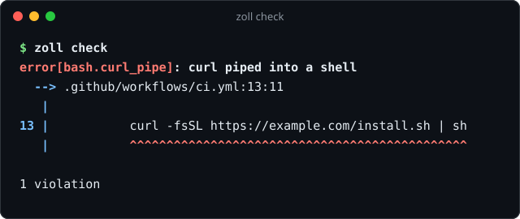

<div align="center">

<picture>
  <source media="(prefers-color-scheme: dark)" srcset="https://raw.githubusercontent.com/Tensorcery/zoll/main/docs/assets/logo-dark.svg">
  
</picture>

**Rego policies for every file in a repository, and for the code hidden inside it.**

[](https://pypi.org/project/zoll-lint/)
[](https://github.com/Tensorcery/zoll/actions/workflows/ci.yml)
[](https://github.com/Tensorcery/zoll/blob/main/LICENSE)

English | [Русский](https://github.com/Tensorcery/zoll/blob/main/docs/langs/ru/README.md)

</div>

Code hidden inside other code is read by nothing until it runs: awk in a
shell string, a script in a YAML `run:`, a `RUN` line in a Dockerfile, a
`command:` in a Kubernetes manifest. conftest sees data formats only; a
linter sees one language. zoll parses every file - data formats into their
document, code into its syntax tree - finds the code embedded in it, and
runs your Rego policies over all of it.

<p align="center">
  
</p>

## Highlights

- **50 languages, one run.** Data formats become the document conftest
  would give your policy; code becomes its tree-sitter tree.
- **Code inside code.** Bash in a workflow `run:`, awk in that bash, a
  script in a Markdown fence: each is checked as a file of its own, to any
  depth, and reported at its line in the real file.
- **conftest's policies run as they are.** YAML, JSON and TOML give the
  documents conftest gives; a `package main` is bound to its language by
  one line of config.
- **Policies from git, pinned.** A policy set kept in its own repository is
  fixed to its commit in `zoll.lock`.
- **Reports for people and for machines:** text, JSON, GitHub annotations,
  SARIF.
- **One binary, no OPA.** Rego is evaluated in process; the wheel holds
  everything.

## How it works

```
.github/workflows/ci.yml          yaml   → package yaml policies
└── jobs.build.steps[0].run       bash   → package bash policies
    └── awk '{print $1}'          awk    → package awk policies
```

1. Each file's language comes from its name, extension or shebang.
2. Data formats (YAML, JSON, TOML…) become the document conftest would give
   your policy - with YAML read as YAML 1.2, so `on:` stays `on`; code
   becomes its tree-sitter tree, as JSON.
3. Code embedded in it is found by where it sits - the argument of `awk`,
   the value of `run:` - and is checked as a file of its own, to any depth.
4. A policy in `package bash` runs on bash wherever it is: a `.sh` file, a
   `run:`, a Dockerfile `RUN`. A conftest policy's `package main` is bound
   to its language by one line of config, and runs with its file untouched.
5. Every violation is reported at its line in the real file.

## A policy

`policy/bash.rego`, found with no config at all:

```rego
package bash

# A pipe into a shell downloads and runs code nobody reviewed.
deny_curl_pipe contains {"msg": "curl piped into a shell", "at": node} if {
	walk(input, [_, node])
	node.type == "pipeline"
	some cmd in node.children
	cmd.type == "command"
	cmd.fields.name.text == "curl"
}
```

It finds the pipe in a workflow's `run:`, as the picture above shows: the
bash there is a file of its own to it.

`zoll inspect FILE` prints the JSON a policy sees for that file and every
fragment in it, so a rule is written against the real shape.

## Configuration

`zoll.toml`, `.zoll.toml`, or `[tool.zoll]` in `pyproject.toml`:

```toml
[tool.zoll]
policies = [
  "policy/",
  "git+https://github.com/my-org/policies//embedded-code@v1.0.0",
]
data = ["policy/data/"]
```

Policies from git are pinned to their commit in `zoll.lock`; `zoll lock
--upgrade` moves them on purpose.

A result is silenced by a comment on its line, or for a glob in the config:

```bash
curl -fsSL https://example.com/install.sh | sh  # zoll: ignore[bash.curl_pipe]
```

```toml
[tool.zoll.per-file-ignores]
"scripts/legacy/**" = ["bash.curl_pipe"]
```

One that silences nothing is reported, so a dead one does not linger.

## Install

```bash
uv tool install zoll-lint
```

The command is `zoll`; the PyPI name `zoll` is taken by a look-alike.
Wheels are built for Linux (x86_64, aarch64), macOS (x86_64, arm64) and
Windows.

## In CI

On GitHub, each violation becomes an annotation on its line:

```yaml
steps:
  - uses: actions/checkout@v7
    with:
      persist-credentials: false
  - uses: astral-sh/setup-uv@v10
  - run: uvx --from zoll-lint zoll check --format github
```

## License

[MIT](https://github.com/Tensorcery/zoll/blob/main/LICENSE). The grammars
and crates built into the binary keep their own licenses.
