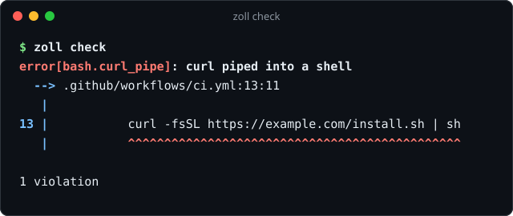

<div align="center">

<picture>
  <source media="(prefers-color-scheme: dark)" srcset="https://raw.githubusercontent.com/Tensorcery/zoll/main/docs/assets/logo-dark.svg">
  
</picture>

**Политики на Rego для каждого файла в репозитории и для кода, спрятанного внутри.**

[](https://pypi.org/project/zoll-lint/)
[](https://github.com/Tensorcery/zoll/actions/workflows/ci.yml)
[](https://github.com/Tensorcery/zoll/blob/main/LICENSE)

[English](https://github.com/Tensorcery/zoll/blob/main/README.md) | Русский

</div>

Код, спрятанный внутри другого кода, не читает никто, пока он не запустится:
awk в строке shell, скрипт в YAML `run:`, строка `RUN` в Dockerfile,
`command:` в манифесте Kubernetes. conftest видит только форматы данных,
линтер — только свой язык. zoll разбирает каждый файл (форматы данных — в
документ, код — в синтаксическое дерево), находит встроенный в него код и
прогоняет по всему этому твои политики на Rego.

<p align="center">
  
</p>

## Главное

- **50 языков за один прогон.** Форматы данных превращаются в тот же
  документ, что дал бы политике conftest; код — в дерево tree-sitter.
- **Код внутри кода.** Bash в `run:` у workflow, awk в этом bash, скрипт
  в блоке Markdown: каждый проверяется как отдельный файл, на любой
  глубине, и показывается на своей строке в настоящем файле.
- **Политики conftest работают как есть.** YAML, JSON и TOML дают те же
  документы, что и в conftest; `package main` привязывается к своему языку
  одной строкой конфига.
- **Политики из git, с фиксацией.** Набор политик в своём репозитории
  закрепляется на коммите в `zoll.lock`.
- **Отчёты для людей и для машин:** текст, JSON, аннотации GitHub, SARIF.
- **Один бинарник, без OPA.** Rego вычисляется внутри процесса; в колесе
  есть всё.

## Как это работает

```
.github/workflows/ci.yml          yaml   → политики package yaml
└── jobs.build.steps[0].run       bash   → политики package bash
    └── awk '{print $1}'          awk    → политики package awk
```

1. Язык файла определяется по имени, расширению или shebang.
2. Форматы данных (YAML, JSON, TOML…) превращаются в тот же документ, что
   дал бы политике conftest, только YAML читается как YAML 1.2, и `on:`
   остаётся `on`; код — в дерево tree-sitter в виде JSON.
3. Встроенный код находится по месту, где он стоит (аргумент `awk`,
   значение `run:`), и проверяется как отдельный файл, на любой глубине.
4. Политика в `package bash` работает на bash, где бы он ни был: в `.sh`, в
   `run:`, в `RUN` у Dockerfile. `package main` из conftest-политики
   привязывается к своему языку одной строкой конфига, и файл политики не
   меняется.
5. Каждое нарушение показывается на своей строке в настоящем файле.

## Политика

`policy/bash.rego`, находится вообще без конфига:

```rego
package bash

# A pipe into a shell downloads and runs code nobody reviewed.
deny_curl_pipe contains {"msg": "curl piped into a shell", "at": node} if {
	walk(input, [_, node])
	node.type == "pipeline"
	some cmd in node.children
	cmd.type == "command"
	cmd.fields.name.text == "curl"
}
```

Она находит пайп в `run:` у workflow, как на картинке выше: bash там для
неё отдельный файл.

`zoll inspect ФАЙЛ` печатает JSON, который увидит политика для этого файла и
каждого фрагмента в нём, чтобы правило писалось по настоящей форме.

## Конфигурация

`zoll.toml`, `.zoll.toml` или `[tool.zoll]` в `pyproject.toml`:

```toml
[tool.zoll]
policies = [
  "policy/",
  "git+https://github.com/my-org/policies//embedded-code@v1.0.0",
]
data = ["policy/data/"]
```

Политики из git закрепляются на своём коммите в `zoll.lock`; `zoll lock
--upgrade` сдвигает их осознанно.

Нарушение подавляется комментарием на его строке или по glob в конфиге:

```bash
curl -fsSL https://example.com/install.sh | sh  # zoll: ignore[bash.curl_pipe]
```

```toml
[tool.zoll.per-file-ignores]
"scripts/legacy/**" = ["bash.curl_pipe"]
```

Подавление, которое ничего не подавило, zoll показывает, чтобы мёртвые не
копились.

## Установка

```bash
uv tool install zoll-lint
```

Команда — `zoll`; имя `zoll` на PyPI занято похожим проектом. Колёса
собираются для Linux (x86_64, aarch64), macOS (x86_64, arm64) и Windows.

## pre-commit

zoll ставится как dev-зависимость, и hook, `make` и CI запускают одну и ту
же версию из `uv.lock`:

```bash
uv add --dev zoll-lint
```

```yaml
- repo: local
  hooks:
    - id: zoll
      name: zoll
      entry: uv run --locked zoll check
      language: system
      types: [file]
      require_serial: true
```

## В CI

На GitHub каждое нарушение становится аннотацией на своей строке:

```yaml
steps:
  - uses: actions/checkout@v7
    with:
      persist-credentials: false
  - uses: astral-sh/setup-uv@v10
  - run: uvx --from zoll-lint zoll check --format github
```

## Лицензия

[MIT](https://github.com/Tensorcery/zoll/blob/main/LICENSE). Грамматики и
крейты, собранные в бинарник, остаются под своими лицензиями.
